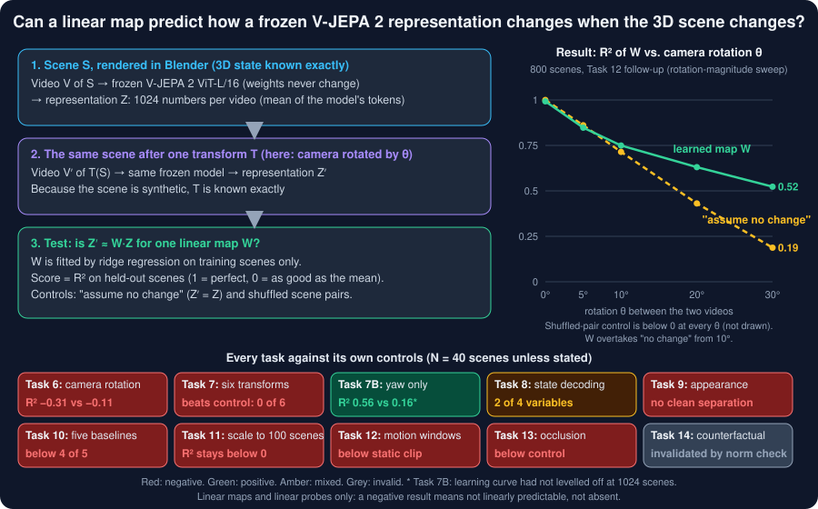

# World-Models: Geometric Consistency Probe

**Question:** does a frozen, pretrained video model (V-JEPA 2 ViT-L/16) represent 3D geometry, or only appearance and temporal patterns?

**Short answer so far:** mostly no under linear tests on small scene sets. The one clear positive result needs about 25 times more training scenes and a narrower transform, and it has not levelled off.



The project is in `geometric-consistency-probe/`. Nothing is trained or fine-tuned: the model is frozen, and every test is a linear ridge regression on held-out scenes.

## Definitions

| Term | Meaning |
| --- | --- |
| Scene `S` | A synthetic 3D scene (1-3 objects, camera, light) with known exact state, rendered in Blender Cycles. |
| Video `V` | 4 frames at 4 fps, 128 px, rendered from `S`. |
| Representation `Z` | 1024 numbers per video: the mean of the frozen model's output tokens. |
| Transform `T` | A known change to the scene: camera translation, camera rotation, object translation, object rotation (geometric), or lighting change, texture change (appearance only). |
| `Z'` | The representation of the video of `T(S)`. |
| Linear map `W` | Ridge regression (alpha 10) fitted on training scenes so that `Z' ≈ W·Z`. |
| R² | Score on held-out scenes. 1 is perfect; 0 equals predicting the mean; below 0 is worse than the mean. |
| Controls | "Persistence" (predict `Z' = Z`), mean (predict the average `Z'`), shuffled pairs (match `Z` to another scene's `Z'`). A result counts only if it beats the best control. |

## Results

Scene counts: N = 40 (32 train, 8 test) unless stated. All numbers are copied from `state/task_NN_result.json` and `reports/final_research_report.md`.

| Task | Test | Result | Verdict |
| --- | --- | --- | --- |
| 6 | Camera rotation, 30°, N = 40 | `W` R² -0.313; best control -0.107 | Negative |
| 7 | Six transforms, same split | `W` beat its best control in 0 of 6 | Negative |
| 7B | Camera yaw only, 1024 train / 219 validation / 220 test scenes, tested once | `W` R² 0.557 (95% CI 0.528-0.580); persistence 0.157; learning curve 0.329 → 0.562 for 64 → 1024 train scenes, not levelled off | Positive, scale-limited |
| 8 | Decode state from `Z` | Elevation R² 0.227 (best control -0.378) and distance 0.349 (0.253) beat controls; azimuth -0.781 and object position -1.653 did not | Mixed, 2 of 4 |
| 9 | Change in `Z` under appearance vs geometric transforms (mean cosine similarity of `Z` and `Z'`) | Lighting 0.974, texture 0.992, camera translation 0.976, camera rotation 0.948, object translation 0.987, object rotation 0.964 | No separation: camera rotation changes `Z` most |
| 10 | Five baselines, camera rotation | `W` R² -0.313; pixel statistics 0.221; untrained encoder 0.781 | Negative: below 4 of 5 |
| 11 | Camera rotation at N = 15 / 40 / 100 | `W` R² -0.050 / -0.163 / -0.020; untrained encoder about 0.75 / 0.67 / 0.71 | Negative at every N |
| 12 | `Z` of video window 2 from window 1, camera orbit | Real motion R² 0.306; static-clip control 0.609 | Negative |
| 13 | Object position after occlusion | Real R² -0.493; scrambled control -0.035; no-occlusion upper bound -0.637 | Negative, and the upper bound failed too |
| 14 | Tell object translation from object rotation (both 0.4 units) | Accuracy 0.625; threshold 0.750; norm-only control 0.938 | Negative and invalidated |

### Follow-ups, each in its own `experiments/` directory

| Follow-up | Result |
| --- | --- |
| Task 12 rotation-size sweep, 800 scenes | Learned `W` vs persistence R²: 0° 0.993 vs 1.000; 5° 0.848 vs 0.861; 10° 0.750 vs 0.714; 20° 0.631 vs 0.431; 30° 0.523 vs 0.188. Shuffled pairs below 0 throughout. |
| Task 12 faster orbit (90°/s), 100 scenes | `W` R² 0.504 beat the standard controls (0.356) but not the static-clip control (0.878). |
| Task 13 at 100 scenes | Real R² -0.007; scrambled -0.359; mean -0.022; no-occlusion bound 0.057. Small margin; Task 13's original negative was partly a small-sample effect. |
| Task 7 camera translation, magnitude 3, 100 scenes | `W` R² -0.524; best control -0.108. Still negative. |
| Task 7 object translation, magnitude 2.0, 100 scenes | `W` R² 0.103 (0.381 at N = 40 in Task 7). Control comparison is in the result file. |
| Task 14 larger displacement (2.0 units), 100 scenes | Invalidated: object rotation cannot move a point more than 1.0 unit, so the two edits were not magnitude-matched (rotation mean 0.72, translation 2.0). |

## Reading the results

- **Rotation size matters.** At 0°-5° "assume no change" wins because almost nothing changed. From 10° the learned map wins and the gap grows. The sweep uses persistence as its control; the static-clip control of the faster-orbit follow-up was not beaten.
- **Scale and transform are confounded.** Task 7B used about 25 times more train scenes and a yaw-only transform at the same time. The evidence cannot say which one produced R² 0.557.
- **Output-level only.** In Task 7B the fitted matrices did not satisfy exact composition and inverse identities (normalised discrepancy 0.65-1.003), though predictions stayed above controls.
- **Not specific to pretraining.** An untrained encoder and a pixel-statistics baseline score higher than the pretrained model on camera rotation at N = 40.
- **Linear only.** A negative result here means "not linearly predictable", not "absent".
- **Nothing here supports "the model understands 3D".**

## Status by category

| Category | Done | Pending (planned) | Not planned (gaps) |
| --- | --- | --- | --- |
| **Specification** | `DESIGN.md` (binding), `IMPLEMENTATION_NOTES.md`, `research/RESEARCH_PLAN.md`, 18 invariants in `research/RESEARCH_INVARIANTS.md` | - | - |
| **Pipeline (Tasks 1-5)** | Scene generation, six transforms, frozen encoder wrapper, extraction checks | - | Only the mean of the tokens is used: no token-level analysis |
| **Experiments (Tasks 6-14)** | All nine, plus 7B and six follow-ups (table above) | - | Six-transform matrix at 7B scale; other motion types and windowing for Task 12; wider label range for Task 13; magnitude ladder for Task 14; alpha sweep (alpha fixed at 10, or 100 in 7B) |
| **Infrastructure (Task 15)** | One result schema, validated on 9 result files with 0 errors, plus a single command-line entry per task | - | - |
| **Report (Task 16)** | `reports/final_research_report.md`: claim-evidence matrix, negative results, limits | - | The Task 10 field `pixel_statistics_comparable_to_primary` is `true` although the R² values differ by about 0.53 (its declared limit is 0.05). Flagged in the report, not fixed. |
| **Release (Task 17)** | Task spec `tasks/17_release.md` written | Prepare the repository for external use | - |
| **Independent audit (Task 18)** | Task spec `tasks/18_audit.md` written | Adversarial pass for leakage, confounds, unsupported claims | - |
| **Scope beyond the plan** | - | - | Real (non-synthetic) video; any encoder other than V-JEPA 2 ViT-L/16; nonlinear probes (excluded on purpose, invariant 13); more than 1-3 objects per scene; a result that separates a geometric effect from architecture alone |
| **Repository hygiene** | MIT `LICENSE`; fast test suite (`pytest -m "not slow"`) | - | Default branch is still named `claude/blissful-meitner-2kz1x1`, not `main`. Most commits are authored by the automated runner. |

## Layout

```
geometric-consistency-probe/
  DESIGN.md                  Research specification: definitions, controls, what a result can and cannot support
  IMPLEMENTATION_NOTES.md    Engineering decisions and corrections
  README.md                  Usage commands for each stage
  research/                  Plan (Tasks 6-18), 18 invariants, canonical protocol
  orchestrator/              Automated task runner with independent checks of each result
  tasks/                     One spec per task
  generation/ transforms/ encoders/ representations/ probes/ metrics/ baselines/ evaluation/
  experiments/               One runner per task; each follow-up in its own directory
  state/                     task_NN_result.json: the source of truth for every number
  reports/                   final_research_report.md
```

## Run

```bash
cd geometric-consistency-probe
python3 -m venv .venv && source .venv/bin/activate
pip install -r requirements.txt
pytest -m "not slow"      # no Blender renders, no model forward passes, no network
```

Rendering needs `bpy` 5.0.1 (about 1 GB, Linux). Per-stage commands are in `geometric-consistency-probe/README.md`.

## License

MIT. See `LICENSE`.
